<p align="center">
  <picture>
    <source media="(prefers-color-scheme: dark)" srcset="./dark.svg">
    <source media="(prefers-color-scheme: light)" srcset="./light.svg">
    
  </picture>
</p>

<p align="center">
  <a href="https://boopalan-d3v.vercel.app"></a>
  <a href="https://linkedin.com/in/boopalans01"></a>
  <a href="mailto:boopalans0112@gmail.com"></a>
  
  
</p>

---

### ⚡ About & Focus

Fullstack Software Engineer at **Grassstone AI** (Bangalore, India) specializing in high-throughput backend microservices, real-time web applications, and AI-powered document extraction pipelines.

- 🏗️ **Core Craft**: Architecting scalable services across React, Next.js, TypeScript, Go, and Node.js.
- 🧠 **AI & Automation**: Engineering document schema extraction workflows using vision models (GLM-OCR) and asynchronous job orchestration with BullMQ & Redis.
- 📐 **Architecture**: Prioritizing clean type contracts, relational data integrity (PostgreSQL), and containerized deployments with Docker and GitHub Actions.
- 🎓 **Education**: B.E. in Computer Science & Engineering from Bharathiar University.

---

### 🛠️ Technical Architecture & Stack

| Category | Technologies & Tools |
| :--- | :--- |
| **Languages** | `TypeScript` · `JavaScript (ESNext)` · `Go (Golang)` · `Python` · `SQL` · `HTML5/CSS3` |
| **Frontend UI** | `React.js` · `Next.js (App Router)` · `Tailwind CSS` · `Canvas API` · `Component Architecture` |
| **Backend & APIs** | `Go HTTP / Chi` · `Node.js` · `Express.js` · `RESTful APIs` · `WebSockets` · `OAuth 2.0` |
| **AI & Workflows** | `GLM-OCR` · `Vision AI Document Parsing` · `Structured JSON Compilation` · `LLM Pipelines` |
| **Queues & Databases** | `PostgreSQL` · `MongoDB` · `MySQL` · `BullMQ` · `Redis` · `AWS S3` |
| **DevOps & Tooling** | `Docker` · `Linux (Ubuntu/Debian)` · `Git` · `GitHub Actions CI/CD` · `Postman CI` |

---

### 🚀 Featured Systems & Production Builds

#### 🔹 [DevBench](https://devbenchio.vercel.app/) — Developer Utilities & Syntax Diff Suite
> **Live Application:** [devbenchio.vercel.app](https://devbenchio.vercel.app/)
- High-efficiency developer workbench featuring real-time, line-by-line syntax diff checking, AST-aware transformations, and live inspection.
- Engineered for instant client-side execution and responsive dark/light developer ergonomics.

#### 🔹 [WindBoard](https://wind-board.vercel.app/) — Real-Time Collaborative Canvas
> **Repository:** [github.com/Boopalan-d3v/wind-board](https://github.com/Boopalan-d3v/wind-board) · **Live Application:** [wind-board.vercel.app](https://wind-board.vercel.app/)
- High-performance infinite canvas whiteboard and visual workspace with fluid vector drawing and task persistence.
- Built with optimized HTML5 canvas rendering and reactive state management.

#### 🔹 AI Document & OCR Extraction Engine @ Grassstone AI
- Production data processing pipeline transforming complex multi-page files into structured JSON schemas.
- Managed asynchronous distributed workers via **BullMQ**, **Node.js**, and **Go**, integrated with vision extraction models.

---

<h2 align="center">📊 GitHub Contributions</h2>

<p align="center">
  <picture>
    <source
      media="(prefers-color-scheme: dark)"
      srcset="https://raw.githubusercontent.com/Boopalan-d3v/Boopalan-d3v/output/github-snake-dark.svg"
    />
    <source
      media="(prefers-color-scheme: light)"
      srcset="https://raw.githubusercontent.com/Boopalan-d3v/Boopalan-d3v/output/github-snake.svg"
    />
    
  </picture>
</p>

<p align="center">
  
</p>

---

<h3 align="center">📈 GitHub Telemetry</h3>

<p align="center">
  
</p>

---

### 📫 Connect & Terminal Session

```bash
boopalan@grassstone:~$ echo "Let's connect and build something extraordinary."
```

- 🌐 **Portfolio**: [boopalan-d3v.vercel.app](https://boopalan-d3v.vercel.app)
- 🐙 **GitHub**: [@Boopalan-d3v](https://github.com/Boopalan-d3v)
- 💼 **LinkedIn**: [in/boopalans01](https://linkedin.com/in/boopalans01)
- ✉️ **Email**: [boopalans0112@gmail.com](mailto:boopalans0112@gmail.com)

<p align="right">
  <sub>Terminal Profile System v2.4 · High-Performance Engineering</sub>
</p>
